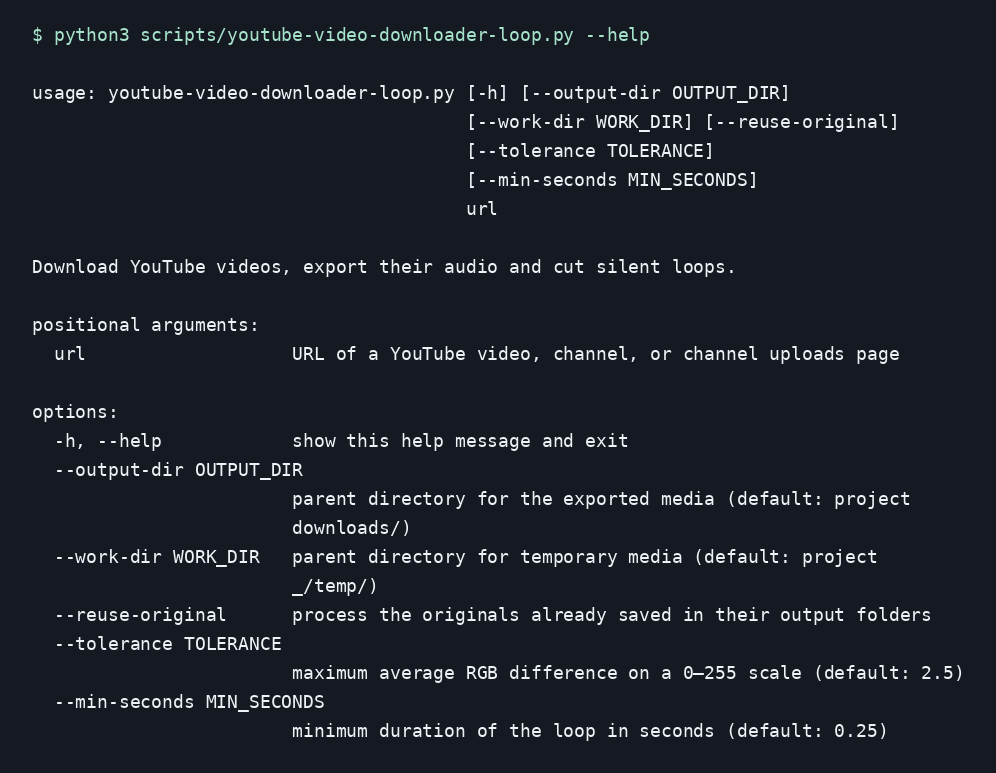

# youtube-video-downloader-loop

This README is also available in:\
en-GB, [en-US](../README.md), [es-AR](README.es-AR.md), [es-ES](README.es-ES.md)

## What is it

A Codex skill that downloads a YouTube video or the videos listed by a channel. For each video it downloads the highest available resolution, exports the full audio as a constant 192 kb/s MP3, and makes a silent loop when it finds a repeat. The files use `Channel - yYYYYmMMdDD - Title` as their name base.

## Screenshots



## Install

Install the base packages as root on Debian 13.

```bash
apt-get update && apt-get install -y python3 python3-numpy python3-scipy ffmpeg ca-certificates curl
```

Install the packages as root on Alpine edge for x86-64 with the community repository enabled.

```bash
apk add python3 py3-numpy py3-scipy ffmpeg deno ca-certificates curl
```

See the manual to finish setting up yt-dlp and Deno. [User manual](MANUAL.en-GB.md#requirements)

## Read the documentation

Use the manual to run the skill and the code reference to see how the loop is detected. [MANUAL](MANUAL.en-GB.md) · [CODE](CODE.en-GB.md)

## Sponsor this project

[Hire me](mailto:nipegun@gmail.com?subject=I%20want%20to%20hire%20you%21) to add new features. [GitHub Sponsors](https://github.com/sponsors/nipegun)
