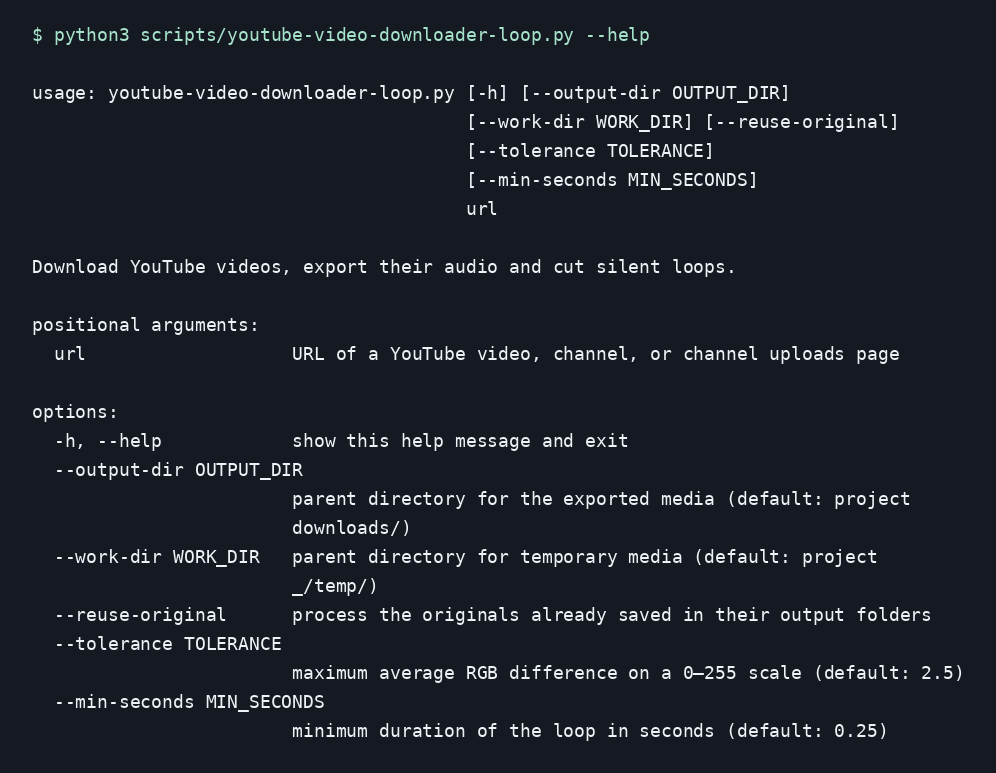

# youtube-video-downloader-loop

This README is also available in:\
[en-GB](README.en-GB.md), [en-US](../README.md), es-AR, [es-ES](README.es-ES.md)

## Qué es

Una skill de Codex que descarga un video de YouTube o los videos listados en un canal. Para cada video, descarga la mayor resolución disponible, exporta el audio completo en MP3 a 192 kb/s constantes y genera un bucle sin sonido si encuentra una repetición. Los archivos usan el nombre base `Canal - yAAAAmMMdDD - Título`.

## Capturas de pantalla



## Instalación

Instalá los paquetes base como usuario root en Debian 13.

```bash
apt-get update && apt-get install -y python3 python3-numpy python3-scipy ffmpeg ca-certificates curl
```

Instalá los paquetes como usuario root en Alpine edge para x86-64 con el repositorio community habilitado.

```bash
apk add python3 py3-numpy py3-scipy ffmpeg deno ca-certificates curl
```

Consultá el manual para terminar de configurar yt-dlp y Deno. [Manual de uso](MANUAL.es-AR.md#requisitos)

## Consultá la documentación

Consultá el manual para ejecutar la skill y la referencia de código para ver cómo se detecta el bucle. [MANUAL](MANUAL.es-AR.md) · [CODE](CODE.es-AR.md)

## Patrociná este proyecto

[Contratame](mailto:nipegun@gmail.com?subject=I%20want%20to%20hire%20you%21) para agregar nuevas funciones. [GitHub Sponsors](https://github.com/sponsors/nipegun)
